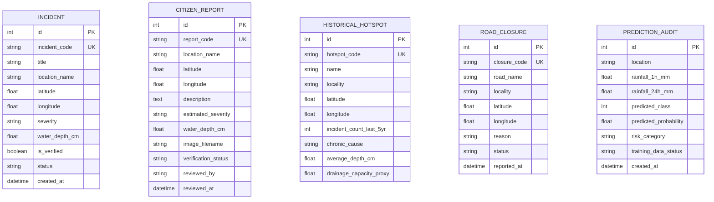

# WaterWatch AI — Complete Technical and Conceptual Project Documentation

> **Real-Time and Predictive Waterlogging Monitoring and Intelligent Route Recommendation System for Nagpur**  
> **Geographic Focus**: Nagpur Metropolitan Area, Maharashtra, India  
> **Academic & Industry Technical Documentation**  
> **Version**: 1.0.0-Release  
> **Documentation Date**: October 2026  
> **Document Status**: Complete Project Reference Specification  

---

## Table of Contents

1. [Project Title and Overview](#1-project-title-and-overview)
2. [Abstract](#2-abstract)
3. [Introduction and Background](#3-introduction-and-background)
4. [Problem Statement](#4-problem-statement)
5. [Motivation and Significance](#5-motivation-and-significance)
6. [Objectives](#6-objectives)
7. [Scope of the Project](#7-scope-of-the-project)
8. [Target Users and Stakeholders](#8-target-users-and-stakeholders)
9. [Existing System and Proposed System](#9-existing-system-and-proposed-system)
10. [System Features and Functional Modules](#10-system-features-and-functional-modules)
    - [10.1 Dashboard and Operational Analytics](#101-dashboard-and-operational-analytics)
    - [10.2 Rainfall-Based Risk Prediction](#102-rainfall-based-risk-prediction)
    - [10.3 Image-Based Waterlogging Detection (YOLOv11)](#103-image-based-waterlogging-detection-yolov11)
    - [10.4 Dual Cartographic Interactive Map (Leaflet & Google Maps)](#104-dual-cartographic-interactive-map-leaflet--google-maps)
    - [10.5 Intelligent Flood-Aware Route Recommendation](#105-intelligent-flood-aware-route-recommendation)
    - [10.6 Citizen Crowdsourced Incident Reporting](#106-citizen-crowdsourced-incident-reporting)
    - [10.7 Historical Chronic Hotspot Analytics](#107-historical-chronic-hotspot-analytics)
    - [10.8 Municipal Authority Verification and Administration](#108-municipal-authority-verification-and-administration)
    - [10.9 Model Provenance and Data Readiness Auditing](#109-model-provenance-and-data-readiness-auditing)
11. [Complete Technology Stack](#11-complete-technology-stack)
12. [System Architecture](#12-system-architecture)
13. [End-to-End Data Flow](#13-end-to-end-data-flow)
    - [Workflow A: Rainfall Risk Inference Pipeline](#workflow-a-rainfall-risk-inference-pipeline)
    - [Workflow B: Optical Surface Flood Detection Pipeline](#workflow-b-optical-surface-flood-detection-pipeline)
    - [Workflow C: Intelligent Route Recommendation Pipeline](#workflow-c-intelligent-route-recommendation-pipeline)
    - [Workflow D: Citizen Incident Lifecycle and Moderation](#workflow-d-citizen-incident-lifecycle-and-moderation)
    - [Workflow E: Historical Hotspot Ingestion and Spatial Querying](#workflow-e-historical-hotspot-ingestion-and-spatial-querying)
14. [Machine Learning — Rainfall-Based Waterlogging Prediction](#14-machine-learning--rainfall-based-waterlogging-prediction)
15. [Experimental Model vs Verified Production Model](#15-experimental-model-vs-verified-production-model)
16. [Computer Vision and YOLO Object Detection](#16-computer-vision-and-yolo-object-detection)
17. [Dataset and Data Sources Inventory](#17-dataset-and-data-sources-inventory)
18. [Genuine Data Requirements and Future Integrations](#18-genuine-data-requirements-and-future-integrations)
19. [Intelligent Route Recommendation — Detailed Engineering](#19-intelligent-route-recommendation--detailed-engineering)
20. [Database Architecture and Data Management](#20-database-architecture-and-data-management)
21. [Complete REST API Documentation](#21-complete-rest-api-documentation)
22. [User Interface and Frontend Workflow Design](#22-user-interface-and-frontend-workflow-design)
23. [Functional and Non-Functional Requirements](#23-functional-and-non-functional-requirements)
24. [Security, Privacy, and Responsible AI Governance](#24-security-privacy-and-responsible-ai-governance)
25. [Testing, Verification, and Code Quality Suite](#25-testing-verification-and-code-quality-suite)
26. [Installation and Execution Guide](#26-installation-and-execution-guide)
27. [Deployment and Operational Considerations](#27-deployment-and-operational-considerations)
28. [Limitations and Technical Challenges](#28-limitations-and-technical-challenges)
29. [Future Scope and Evolution Roadmap](#29-future-scope-and-evolution-roadmap)
30. [Expected Impact and Practical Applications](#30-expected-impact-and-practical-applications)
31. [Project Novelty and Differentiation](#31-project-novelty-and-differentiation)
32. [Conclusion](#32-conclusion)
33. [Glossary of Technical Terms](#33-glossary-of-technical-terms)
34. [References and External Resources](#34-references-and-external-resources)
35. [Appendix](#35-appendix)

---

## 1. Project Title and Overview

- **Project Name:** WaterWatch AI
- **Full Formal Title:** Real-Time and Predictive Waterlogging Monitoring and Intelligent Route Recommendation System for Nagpur
- **Project Domain:** Smart Cities, Intelligent Transportation Systems (ITS), Applied Artificial Intelligence, Hydrometeorological Analytics, and Geospatial Information Systems (GIS).
- **Primary Geographic Target:** Nagpur Metropolitan Area (Nagpur Municipal Corporation - NMC jurisdiction), Vidarbha Region, Maharashtra, India.
- **Repository Branch:** `fullstack` / Root Pipeline

### Abstract Summary
WaterWatch AI is an integrated software platform engineered to monitor, predict, visualize, and circumvent urban roadway waterlogging. The system unifies multi-interval hydrometeorological analysis, computer vision surface puddle detection, crowdsourced civic incident reporting, and spatial hazard-aware route planning into an interactive, glassmorphic digital cockpit.

### Detailed Introduction
Urban waterlogging is a chronic challenge confronting rapidly expanding metropolitan centers across India. During the Southwest Monsoon (June through September), intense convective precipitation events frequently exceed the hydraulic clearance capacity of municipal stormwater conduits. In Nagpur—the third-largest city in Maharashtra and the winter capital of the state—depressed railway underpasses (such as Narendra Nagar RUB and Anand Talkies Underbridge), low-lying riverbank localities (such as Sitabuldi and Dhantoli near the Nag River), and major arterial transit corridors experience localized inundation. Such flooding causes severe vehicular stalling, gridlock, economic interruption, and perilous travel conditions for emergency services and daily commuters.

Conventionally, urban flood management has functioned reactively. Citizens encounter submerged streets unexpectedly; municipal emergency teams learn of blockages hours later through distressed phone calls; and standard satellite navigation applications (such as Google Maps or Apple Maps) continue routing vehicles through flooded low-lying culverts because navigation algorithms optimize for dry-weather speed or distance rather than hydrometeorological risk.

### The Core Architectural Premise
WaterWatch AI bridges the divide between **predictive atmospheric hazard estimation**, **optical computer vision verification**, and **dynamic road navigation**. By establishing an architecture that evaluates multi-interval precipitation (1h, 3h, 6h, 24h, and 72h antecedent soil moisture), computer vision models trained on roadway inundation, crowdsourced civic reports, and live roadway closure buffers, WaterWatch AI calculates localized flood hazard scores. These scores are projected directly onto navigable routes, allowing citizens to choose safe, flood-averted routes and enabling municipal dispatchers to allocate drainage pumps with data-backed priority.

```
+-----------------------------------------------------------------------------+
|                               WATERWATCH AI                                 |
|         Hydrometeorology + Computer Vision + GIS Navigation Cockpit         |
+-----------------------------------------------------------------------------+
        |                                     |                         |
        v                                     v                         v
 [ PREDICTION ]                        [ DETECTION ]              [ NAVIGATION ]
 Multi-interval rainfall               YOLOv11 deep learning      Spatial hazard routing
 & antecedent soil moisture            optical flood detection    & multi-criterion paths
 (1h, 3h, 6h, 24h, 72h)                (Bounding box inference)   (Fastest, Safest, Balanced)
```

---

## 2. Abstract

Urban pluvial flooding and road waterlogging represent significant threats to municipal mobility, public safety, and economic productivity across developing urban centers. In cities like Nagpur, localized topographical depressions and rapid urbanization with high impervious surface ratios lead to rapid water accumulation during monsoon downpours. Conventional traffic management and navigation platforms operate reactively, relying on delayed crowdsourced traffic slowdown markers that fail to identify submerged water depth or emerging stormwater hazards before vehicles enter flooded corridors.

This project presents **WaterWatch AI**, a multi-tiered engineering system designed to combine predictive hydrological estimation, computer vision surface detection, and flood-resilient route planning. The platform integrates:
1. A multi-scale temporal rainfall feature engineering engine capturing acute rainfall intensity (1h, 3h, 6h) alongside antecedent soil saturation (24h, 72h, and 7-day Antecedent Precipitation Index).
2. An experimental supervised classification pipeline and transparent India Meteorological Department (IMD) rule-based baseline estimator.
3. A fine-tuned Ultralytics YOLOv11 nano object detection model capable of localizing surface water pooling in roadway photographs.
4. A spatial risk-scoring routing engine that overlays active verified municipal incidents, chronic railway underpass hotspots, road closures, and unverified citizen reports over candidate road corridors obtained via Open Source Routing Machine (OSRM).
5. A full-stack web dashboard built with Next.js 14, TypeScript, Leaflet, Google Maps JavaScript API, and FastAPI with SQLite.

The current implementation includes an operational, fully decoupled full-stack prototype with 48 automated test suites passing (37 pipeline/ML tests and 11 integration API tests). In accordance with strict scientific integrity, the project distinguishes between an **experimental synthetic dataset model** (`SYNTHETIC_EXPERIMENTAL`) used for end-to-end integration demonstration and the **verified production municipal model**, which remains documented as `BLOCKED_ON_VERIFIED_DATA` pending formal ingestion of time-stamped municipal incident ground truth from local authorities.

---

## 3. Introduction and Background

### Urban Pluvial Waterlogging Dynamics
Urban waterlogging (or pluvial flooding) occurs when rainwater accumulates in urban streets and low-lying topography at a rate exceeding the drainage network's infiltration and discharge rate. Unlike fluvial (riverine) flooding, which develops over days as major river basins rise, pluvial waterlogging is localized, acute, and can inundate road networks within 15 to 45 minutes of a localized storm cell.

### The Physics of Waterlogging: Rainfall vs. Topography vs. Drainage
The onset and severity of waterlogging are governed by four intersecting factors:
$$\text{Waterlogging Risk} = f(\text{Acute Rainfall Intensity}, \text{Antecedent Soil Moisture}, \text{Local Topography / Depression}, \text{Drainage Capacity})$$

1. **Acute Rainfall Intensity (1h, 3h):** High-intensity rainfall bursts ($>30\text{ mm/hr}$) quickly saturate localized surface inlets. Urban road gutters are typically designed for rainfall rates of $20-25\text{ mm/hr}$; storms exceeding this rate result in gutter surcharge and street sheet flow.
2. **Antecedent Rainfall (24h, 72h, API):** Prior rainfall saturates unpaved soils, raises the local groundwater table, and fills retention basins. When soil moisture capacity reaches 100%, nearly all subsequent precipitation converts directly into surface runoff (runoff coefficient $C \to 0.95$).
3. **Micro-Topography:** Depressed vertical alignments—specifically Railway Underbridges (RUBs) and road underpasses—act as natural collection basins for surrounding urban micro-catchments.
4. **Drainage Infrastructure:** Siltation, debris accumulation, undersized masonry culverts, and high receiving water levels (such as backflow from overflowing urban streams) reduce drainage discharge to near zero.

### The Nagpur Hydrological Context
Nagpur lies within the Kanhan-Wainganga sub-basin. Natural surface runoff across Nagpur discharges into three major urban streams (nallas):
- **The Nag River:** Originating from Ambazari Lake overflow, traversing southwest to east across the city center.
- **The Pili River:** Draining the northern residential and industrial zones into the Kanhan River.
- **The Pora River:** Draining the southern municipal sectors.

During heavy monsoon storms, elevated water stages in the Nag and Pili rivers create backwater pressure at stormwater outfalls. Consequently, central areas such as Sitabuldi and Dhantoli experience prolonged roadway inundation even after storm downpours subside. Furthermore, critical transport arteries rely on concave railway underpasses—such as Narendra Nagar RUB, Manish Nagar RUB, and Anand Talkies Underpass—which accumulate dangerous water levels ($>45\text{ cm}$) during cloudburst events.

---

## 4. Problem Statement

Modern urban road networks in medium and large Indian cities suffer from severe information fragmentation during monsoon storm events. Specifically:

1. **Information Asymmetry and Delays:** Commuters have no reliable, pre-trip digital mechanism to determine whether their planned travel route traverses waterlogged roads or closed underpasses. Information is typically shared via unstructured social media posts, word of mouth, or local radio hours after gridlock has already occurred.
2. **Inadequacy of Traditional Traffic Navigation:** Standard GPS navigation platforms optimize for minimum travel time or Euclidean distance using dry-weather road graphs. When low-lying roads submerge, drivers following navigation apps are directed into deep floodwaters, resulting in stranded vehicles, engine hydraulic lock, and blocked emergency lanes.
3. **Decoupled Meteorological and Civic Data:** Weather radar provides regional rainfall totals, but does not identify which specific municipal junctions are impassable. Conversely, municipal complaint logs record flooded addresses but do not forecast which adjacent transit corridors will become submerged next as rainfall intensifies.
4. **Verification Lag:** Unverified public complaints can create false alarms, while genuine, dangerous road closures often go unbroadcasted on public maps for hours due to manual review bottlenecks.
5. **Data Scarcity for Machine Learning:** Municipal corporations rarely maintain structured, geocoded, time-stamped databases of past flooding incidents linked to high-resolution automated rain gauges. This impedes the direct training of supervised machine learning algorithms without transparent data collection protocols.

---

## 5. Motivation and Significance

WaterWatch AI addresses these challenges through an open, modular, and scientifically honest computational platform:

- **Commuter Safety and Asset Protection:** Preventing private vehicles, buses, and two-wheelers from entering water columns exceeding dangerous engine-submersion thresholds ($>20-30\text{ cm}$).
- **Emergency Service Dispatch:** Providing ambulances, fire engines, and police units with alternative, flood-averted routes during extreme weather emergencies.
- **Municipal Resource Optimization:** Assisting municipal disaster response cells (e.g., Nagpur Municipal Corporation) by highlighting chronic hotspots and unverified citizen reports that require mobile de-watering pump deployment.
- **Educational and Engineering Excellence:** Demonstrating how modern full-stack web engineering, cloud-ready REST architectures, computer vision (YOLOv11), and hydrometeorological feature engineering can be combined into a functional decision-support system.
- **Support for Smart City Infrastructure:** Laying the foundational architectural framework for smart city initiatives (such as Nagpur Smart and Sustainable City Development Corporation Limited - NSSCDCL) to ingest CCTV feeds and rain gauge networks into automated traffic guidance.

---

## 6. Objectives

The primary engineering and research objectives of WaterWatch AI are categorized below with their verified implementation status in the repository:

| # | Objective Description | Target Area | Implementation Status | Verification Source |
|---|---|---|---|---|
| **O1** | Multi-interval hydrometeorological feature engineering (1h, 3h, 6h, 24h, 72h, API) | ML Pipeline | **Implemented** | [build_rainfall_features.py](file:///d:/PROJECTS/WaterWatch%20%28ML%20model%29/scripts/build_rainfall_features.py) |
| **O2** | Rule-based meteorological risk baseline calibrated to IMD thresholds | ML Baseline | **Implemented** | `models/rainfall/experimental_risk_baseline.joblib` |
| **O3** | Supervised tabular classifier comparison (Logistic Regression, Random Forest, HistGB) | ML Experiment | **Implemented (Synthetic)** | `models/rainfall/synthetic_rainfall_model.joblib` |
| **O4** | Verified municipal incident data ingestion and schema validation | Data Integrity | **Implemented (Schema & CLI)** | `data/manifests/waterlogging_event_schema.json` |
| **O5** | Training on genuine municipal ground-truth flood incident records | Production ML | **Blocked on Data** | `reports/rainfall_model_training_report.md` |
| **O6** | Optical roadway waterlogging detection using deep learning object detection | Computer Vision | **Implemented (YOLOv11n)** | `models/image/best.pt` |
| **O7** | Dual interactive mapping interface (Leaflet & Google Maps JS API) | Frontend UI | **Implemented** | `LeafletMapComponent.tsx`, `GoogleMapComponent.tsx` |
| **O8** | Spatial hazard route recommendation (Fastest, Lowest Risk, Balanced) | Routing Engine | **Implemented** | `routing_service.py`, `risk_scoring.py` |
| **O9** | Crowdsourced citizen incident reporting with photo upload | Civic Workflow | **Implemented** | `CitizenReportView.tsx`, `/api/v1/reports` |
| **O10** | Municipal authority moderation workflow for incident verification | Admin Workflow | **Implemented** | `AdminReviewModal.tsx`, `/api/v1/reports/{code}/review` |
| **O11** | Historical chronic underpass hotspot analytics and visualization | Urban Analytics | **Implemented** | `HotspotsAnalyticsView.tsx`, `/api/v1/hotspots` |
| **O12** | Live Open-Meteo weather integration with offline resilience fallback | Live Telemetry | **Implemented** | `weather_adapter.py` |
| **O13** | Automated software regression test suite | QA & Reliability | **Implemented (48/48 Passing)** | `tests/`, `backend/tests/` |

---

## 7. Scope of the Project

### Current Operational Scope
1. **Geographic Coverage:** Dedicated focus on Nagpur District, Maharashtra, with landmark-specific coordinates for core zones (Sitabuldi, Dharampeth, Sadar, Dhantoli, Narendra Nagar, Manish Nagar, Mankapur).
2. **Current Machine Learning Scope:**
   - Rainfall model operates as an **experimental synthetic integration** (`SYNTHETIC_EXPERIMENTAL`). It accepts 6 hydrometeorological features and generates probability scores and categorical risk tiers.
   - An IMD-calibrated meteorological baseline (`ExperimentalMeteorologicalRiskBaseline`) is serialized for rule-based risk auditing without synthetic assumptions.
   - YOLOv11 nano model (`best.pt`) detects visible surface water pooling in street photographs.
3. **Routing Scope:** Queries live OSRM road geometry with automated fallback to verified Nagpur arterial road corridors when external routing services are unreachable. Evaluates spatial hazard intersections within 250m–350m buffer zones.
4. **Platform Scope:** Web application featuring an interactive dashboard, live map, incident reporting, route planner, and municipal administration interface.

### Boundaries and Out-of-Scope Items
- **Not an Official Municipal Dispatch System:** The software is a technical demonstration and prototype. It has not been formally deployed by the Nagpur Municipal Corporation (NMC) or Nagpur Traffic Police.
- **Physical Water Depth Invariance:** The optical camera detector locates water surface boundaries, but cannot measure vertical water depth in centimeters without physical staff gauges or calibrated infrastructure reference markers.
- **No Direct Sensor Hardware:** The repository does not include physical IoT ultrasonic water level sensors or telemetry rain gauges; it ingests data via CSV feeds, Open-Meteo REST endpoints, and synthetic demonstration matrices.

---

## 8. Target Users and Stakeholders

```
+--------------------------------------------------------------------------+
|                        WATERWATCH AI STAKEHOLDERS                        |
+--------------------------------------------------------------------------+
       |                                   |                         |
       v                                   v                         v
 [ CITIZENS / COMMUTERS ]         [ MUNICIPAL AUTHORITIES ]    [ EMERGENCY RESPONDERS ]
 - Pre-trip safe routing          - Incident verification      - Fast, flood-averted routes
 - Real-time hazard map           - De-watering pump dispatch  - Hazard proximity alerts
 - Incident reporting with photo  - Chronic hotspot planning   - Reliable alternative paths
```

1. **Citizens and Daily Commuters:** Daily travelers navigating Nagpur on two-wheelers, auto-rickshaws, and cars. They use the platform to check live waterlogging maps, query safe routes before departing, and submit geocoded incident alerts.
2. **Municipal Engineers & Urban Planners (NMC):** Disaster cell personnel seeking real-time situational awareness. They review crowdsourced incident reports, verify them, monitor chronic underpass bottlenecks, and allocate emergency mobile de-watering pumps.
3. **Emergency Medical and Fire Services:** Ambulance and emergency responders requiring clear, flood-averted routing to reach regional hospitals (such as AIIMS Nagpur or Government Medical College) without risk of stalling in submerged underpasses.
4. **Traffic Police:** Officers managing junction diversions and authorizing physical road closures at inundated underpasses.
5. **Academic Evaluators and Researchers:** Faculty, students, and engineers evaluating the practical synthesis of machine learning, computer vision, geospatial routing, and software architecture.

---

## 9. Existing System and Proposed System

### Limitations of Existing Approaches
Urban navigation and flood management currently rely on disconnected tools:
- **Radio & Social Media Feeds:** Updates are slow, lack geographic coordinate boundaries, and cannot be ingested by automated navigation algorithms.
- **Standard Navigation Systems (Google Maps, Waze):** Calculate routes based on traffic speed. When a road is submerged, traffic slows or stops; however, the algorithm interprets this as heavy traffic and may still direct vehicles through the flooded zone until enough vehicles stall to cause complete cessation of motion.
- **Government Flood Portals:** Large river basin portals (e.g., Central Water Commission) monitor major reservoir levels and regional river stages, but provide zero street-level granularity on whether a neighborhood railway underpass has accumulated 40 cm of rainwater.

### Comparison Matrix

| Evaluation Dimension | Conventional Approach | WaterWatch AI Proposed Architecture |
|---|---|---|
| **Primary Data Source** | Delayed crowdsourced traffic delays or emergency phone calls | Triangulated: Rain gauges + Computer Vision + Verified Incidents + Civic Reports |
| **Rainfall Hazard Prediction** | General city-wide weather forecasts (e.g. "Heavy rain in Nagpur") | Localized multi-interval rolling hazard score (1h, 3h, 6h, 24h, 72h + soil saturation) |
| **Visual Flood Verification** | Manual physical inspection by patrol vans | Automated YOLOv11 deep learning object detection from uploaded street images |
| **Route Optimization Metric** | Travel time / Euclidean distance only | Multi-criterion optimization: **Fastest**, **Lowest Risk**, or **Balanced** |
| **Spatial Hazard Awareness** | None (roads treated as dry unless manually marked closed) | Buffer zone intersection against active closures, verified floods, and chronic underpasses |
| **Citizen Involvement** | Voice calls to municipal helpline (unstructured, non-geocoded) | Structured web reporting with geocoded coordinates, severity, and photo upload |
| **Verification Gate** | Manual paper logging or slow dispatch verification | Integrated Authority Review interface with one-click verification and elevation |
| **Model Transparency** | Black-box or absent | Explicitly audits and displays `SYNTHETIC_EXPERIMENTAL` vs `BLOCKED ON DATA` provenance |

---

## 10. System Features and Functional Modules

WaterWatch AI consists of nine functional modules:

```
+----------------------------------------------------------------------------------------------------+
|                                    WATERWATCH AI CORE MODULES                                      |
+----------------------------------------------------------------------------------------------------+
| [1] Dashboard & KPIs        | [2] Rainfall ML Inference     | [3] YOLOv11 Optical Detection        |
| [4] Interactive Dual Maps   | [5] Flood-Aware Route Planner | [6] Citizen Incident Reporting       |
| [7] Chronic Hotspot System  | [8] Authority Review & Admin  | [9] Model Provenance Auditing        |
+----------------------------------------------------------------------------------------------------+
```

### 10.1 Dashboard and Operational Analytics
- **Purpose:** Central operational command center displaying high-impact Key Performance Indicators (KPIs).
- **Inputs:** Database aggregates from `incidents`, `road_closures`, `citizen_reports`, and `historical_hotspots`.
- **Processing:** Calculates total active emergencies, impassable roadways, pending civic tickets, and active weather condition summaries.
- **Outputs:** Glassmorphic metric cards, active incident feeds, live rainfall telemetry ticker, and quick navigation shortcuts.
- **Dependencies:** `waterwatch_integration/frontend/src/components/LiveDashboardView.tsx`, `/api/v1/dashboard/summary`.
- **Status:** **Fully Implemented**.

### 10.2 Rainfall-Based Risk Prediction
- **Purpose:** Evaluates localized pluvial waterlogging probability and categorical hazard tiers.
- **Inputs:** 6 hydrometeorological parameters: `rainfall_1h_mm`, `rainfall_3h_mm`, `rainfall_6h_mm`, `rainfall_24h_mm`, `rainfall_prev_72h_mm`, and `drainage_capacity_proxy`.
- **Processing:** Standardizes input vector via pre-fit `StandardScaler` and executes logistic regression inference; maps output probability to risk tiers (`LOW`, `MODERATE`, `HIGH`, `CRITICAL`).
- **Outputs:** Probability percentage, risk tier, confidence metric, and explicit transparency disclaimer.
- **Dependencies:** `rainfall_adapter.py`, `models/rainfall/synthetic_rainfall_model.joblib`.
- **Status:** **Fully Implemented (Synthetic Experimental)**.

### 10.3 Image-Based Waterlogging Detection (YOLOv11)
- **Purpose:** Identifies and localizes optical surface water pooling in roadway photos.
- **Inputs:** Uploaded JPEG/PNG images or sample street photographs.
- **Processing:** Scales image to 640x640, passes tensor through `yolo11n.pt`, applies non-maximum suppression (NMS) with configurable confidence threshold ($0.10 - 0.90$).
- **Outputs:** Normalized bounding box coordinates `[x1, y1, x2, y2]`, detection confidence score, detection flag (`WATERLOGGING_CONFIRMED` vs `NO_SURFACE_WATERLOGGING_DETECTED`), and rendered canvas overlays.
- **Dependencies:** `image_adapter.py`, `models/image/best.pt`, Ultralytics library.
- **Status:** **Fully Implemented (Experimental Visual Detector)**.

### 10.4 Dual Cartographic Interactive Map (Leaflet & Google Maps)
- **Purpose:** Geospatial visualization of all city-wide waterlogging assets across Nagpur.
- **Inputs:** Coordinate streams from backend endpoints for incidents, hotspots, closures, and reports.
- **Processing:** Renders interactive markers, dynamic color-coded cluster points, risk corridors, and polyline routes.
- **Features:** Toggleable layer filters (Active Incidents, Chronic Hotspots, Road Closures, Citizen Reports), high-contrast dark cartography, pan-to-zoom on selected incidents.
- **Dependencies:** `LeafletMapComponent.tsx` (OpenStreetMap tiles) and `GoogleMapComponent.tsx` (Google Maps JS API key `AIzaSyBFzK...`).
- **Status:** **Fully Implemented**.

### 10.5 Intelligent Flood-Aware Route Recommendation
- **Purpose:** Evaluates and recommends navigable road corridors between an origin and destination based on waterlogging hazards.
- **Inputs:** Origin coordinate `(lat, lon)`, destination coordinate `(lat, lon)`, and user preference mode (`fastest`, `lowest_risk`, `balanced`).
- **Processing:**
  1. Requests alternative roadway polylines from OSRM (or activates Nagpur arterial fallback corridors).
  2. Spatially intersects route geometry against all active road closures, verified severe incidents, chronic underpasses, and unverified reports.
  3. Computes cumulative risk score $\in [0.0, 1.0]$.
  4. Selects and explains the recommended route based on user preference.
- **Outputs:** Route polylines, travel distance (km), estimated duration (min), risk tier, list of proximate hazard factors with distances, and step-by-step recommendation rationales.
- **Dependencies:** `routing_service.py`, `risk_scoring.py`, `/api/v1/routes/recommend`.
- **Status:** **Fully Implemented**.

### 10.6 Citizen Crowdsourced Incident Reporting
- **Purpose:** Allows citizens to submit geolocated waterlogging hazard tickets.
- **Inputs:** Location name, GPS latitude/longitude, narrative description, estimated severity (`Low`, `Moderate`, `High`, `Critical`), water depth estimate (cm), reporter contact, and optional photograph.
- **Processing:** Validates input parameters, saves uploaded image to `data/uploads/`, assigns a unique sequential tracking code (e.g. `REP-NGP-2026-003`), and persists record with status `UNVERIFIED`.
- **Outputs:** Citizen submission receipt and moderation card in authority review feed.
- **Dependencies:** `CitizenReportView.tsx`, `/api/v1/reports`, SQLite `citizen_reports` table.
- **Status:** **Fully Implemented**.

### 10.7 Historical Chronic Hotspot Analytics
- **Purpose:** Maintains a catalog of recurring flood locations across Nagpur.
- **Inputs:** Historical database of known drainage bottlenecks (e.g. Narendra Nagar RUB, Mor Bhavan, Law College Square).
- **Processing:** Aggregates 5-year flood recurrence frequencies, structural causes, average measured depths, drainage proxies, and rainfall threshold triggers.
- **Outputs:** Analytics table, vulnerability ranking, and spatial proximity buffers for routing.
- **Dependencies:** `HotspotsAnalyticsView.tsx`, `/api/v1/hotspots`, SQLite `historical_hotspots` table.
- **Status:** **Fully Implemented**.

### 10.8 Municipal Authority Verification and Administration
- **Purpose:** Control panel for municipal officers to audit citizen reports before elevating them to official public maps.
- **Inputs:** Authority review decisions: `VERIFY` (elevates report to an active verified `Incident` and triggers road closure if critical) or `REJECT` (marks report discarded with reviewer notes).
- **Processing:** Executes atomic database transaction linking reviewer identity and timestamp to report audit logs.
- **Outputs:** Updated system-wide incident state and cleared review queue.
- **Dependencies:** `AdminReviewModal.tsx`, `/api/v1/reports/{report_code}/review`.
- **Status:** **Fully Implemented**.

### 10.9 Model Provenance and Data Readiness Auditing
- **Purpose:** Scientific transparency dashboard communicating the exact engineering status of all AI models.
- **Features:** Discloses that the synthetic rainfall model is an experimental integration, documents the `BLOCKED ON DATA` status of the production model, displays test metrics, and itemizes data prerequisites for municipal validation.
- **Dependencies:** `ModelStatusView.tsx`, `/api/v1/models/status`.
- **Status:** **Fully Implemented**.

---

## 11. Complete Technology Stack

The following table itemizes the technologies, frameworks, and libraries verified to be active in the repository:

| Category | Technology | Version | Purpose in Project | Implementation File / Evidence |
|---|---|---|---|---|
| **Frontend Framework** | Next.js (App Router) | `14.2.15` / `14.2.35` | Server-rendered & client-interactive web dashboard | `waterwatch_integration/frontend/package.json` |
| **Frontend Runtime** | React / React DOM | `18.3.1` | Component lifecycle and reactive UI state management | `waterwatch_integration/frontend/package.json` |
| **Language (Frontend)** | TypeScript | `5.6.3` | Strongly-typed interfaces for models, APIs, and components | `tsconfig.json`, `src/types/index.ts` |
| **Iconography** | Lucide React | `0.453.0` | Cartographic, hazard, and operational UI icons | `src/components/*.tsx` |
| **Mapping (Primary)** | Leaflet & React Leaflet | `1.9.4` | Open-source interactive map with OpenStreetMap tiles | `src/components/LeafletMapComponent.tsx` |
| **Mapping (Secondary)** | Google Maps JS API | Dynamic | Alternative cartographic rendering with dark styling | `src/components/GoogleMapComponent.tsx` |
| **Styling** | Vanilla Modular CSS | CSS3 Custom Properties | Glassmorphic dark styling, responsive layouts | `src/app/globals.css` |
| **Backend Framework** | FastAPI | `0.115+` | High-performance asynchronous REST API server | `waterwatch_integration/backend/app/main.py` |
| **ASGI Web Server** | Uvicorn | `0.32+` | Production ASGI web server running on port 8080 | `waterwatch_integration/run_integration.py` |
| **Language (Backend)** | Python | `3.13.1` / `3.13.12` | Core runtime for APIs, ML pipeline, and data processing | Root Python scripts and backend modules |
| **Object Relational Mapper** | SQLAlchemy | `2.0+` | Database schema definition, queries, and connection pools | `backend/app/database/models.py` |
| **Database Engine** | SQLite 3 | Embedded | Isolated local relational storage for integration data | `waterwatch_integration/data/waterwatch_integration.db` |
| **Data Validation** | Pydantic V2 | `2.0+` | Request/response data contract enforcement and serialization | `backend/app/schemas/*.py` |
| **Tabular Data Processing** | Pandas | `2.0+` | Data cleaning, rolling window aggregations, CSV audits | `scripts/build_rainfall_features.py` |
| **Numerical Processing** | NumPy | `1.24+` / `2.1+` | Matrix operations, vectorized math, and coordinate arrays | `scripts/rainfall_model_utils.py` |
| **Machine Learning** | Scikit-Learn | `1.3+` / `1.5+` | StandardScaler, LogisticRegression, RandomForest, HistGB | `ml/rainfall/train_rainfall_model.py` |
| **Model Serialization** | Joblib | `1.4+` | Serializing/deserializing trained models and pipelines | `models/rainfall/*.joblib` |
| **Deep Learning (Vision)** | Ultralytics YOLOv11 | `8.3+` | Object detection pipeline for roadway waterlogging | `scripts/train_image_model.py`, `models/image/best.pt` |
| **Deep Learning Engine** | PyTorch / Torchvision | `2.0+` / `2.14+` | Tensor execution backend for YOLOv11 on CPU/CUDA | `requirements.txt` |
| **Image Processing** | Pillow (PIL) | `9.0+` / `10.0+` | Image validation, resizing, format conversion, and EXIF check | `backend/app/adapters/image_adapter.py` |
| **Routing Provider** | OSRM Public API | HTTP REST | External roadway graph calculation and polyline retrieval | `backend/app/services/routing_service.py` |
| **Weather Telemetry** | Open-Meteo API | HTTP REST | Real-time precipitation and temperature observations | `backend/app/adapters/weather_adapter.py` |
| **Automated Testing** | Pytest | `7.0+` / `8.3+` | Unit, integration, pipeline, and schema regression tests | `tests/`, `backend/tests/` |
| **HTTP Client (Testing)** | FastAPI TestClient / HTTPX | `0.27+` | Headless API route verification without browser dependencies | `backend/tests/test_integration_api.py` |

---

## 12. System Architecture

The following Mermaid diagram represents the complete architecture of WaterWatch AI, showing client interfaces, backend endpoints, computational services, and persistent storage layers:

```mermaid
graph TD
    subgraph Client_Layer["Frontend Client Layer (Next.js 14 / TypeScript)"]
        UI_Dash["Dashboard & KPI Cockpit<br/>(LiveDashboardView)"]
        UI_Map["Dual Cartographic View<br/>(Leaflet & Google Maps)"]
        UI_Route["Safe Route Planner<br/>(RouteRecommendationView)"]
        UI_Predict["ML Prediction Gauge<br/>(RainfallPredictionView)"]
        UI_Vision["YOLOv11 Detection Canvas<br/>(ImageDetectionView)"]
        UI_Report["Civic Reporting & Admin<br/>(CitizenReportView & Modal)"]
    end

    subgraph API_Gateway["Backend API Gateway (FastAPI on Port 8080)"]
        EP_Health["/api/v1/health<br/>/api/v1/dashboard/summary"]
        EP_Rain["/api/v1/predictions/rainfall<br/>/api/v1/rainfall/observations"]
        EP_Vision["/api/v1/detection/image"]
        EP_Routes["/api/v1/routes/recommend"]
        EP_Civic["/api/v1/reports<br/>/api/v1/incidents & closures"]
        EP_Hotspots["/api/v1/hotspots"]
    end

    subgraph Service_Logic["Computational Services & Logic Layer"]
        SVC_Risk["Route Risk Scoring Engine<br/>(Spatial Buffer Intersect)"]
        SVC_Routing["Routing Service<br/>(Multi-Criterion Ranking)"]
        SVC_Weather["Weather Adapter<br/>(Open-Meteo Client + Fallback)"]
        ADAPT_Rain["Rainfall Model Adapter<br/>(Read-Only StandardScaler)"]
        ADAPT_Image["YOLOv11 Image Adapter<br/>(Ultralytics Inference Engine)"]
    end

    subgraph Model_Artifacts["Pre-Trained Machine Learning Artifacts"]
        ART_Rain["Synthetic Rainfall Model<br/>(models/rainfall/synthetic_rainfall_model.joblib)"]
        ART_Base["Meteorological Baseline<br/>(models/rainfall/experimental_risk_baseline.joblib)"]
        ART_Vision["YOLOv11 Object Detector<br/>(models/image/best.pt)"]
    end

    subgraph Data_Layer["Data Persistence & External Services"]
        DB_Sqlite[("SQLite Relational DB<br/>waterwatch_integration.db")]
        FS_Uploads["File Storage<br/>(data/uploads/)"]
        EXT_OSRM["External OSRM API<br/>(Roadway Graph)"]
        EXT_Meteo["External Open-Meteo API<br/>(Nagpur Weather)"]
    end

    %% Client to API Connections
    UI_Dash --> EP_Health
    UI_Predict --> EP_Rain
    UI_Vision --> EP_Vision
    UI_Route --> EP_Routes
    UI_Report --> EP_Civic
    UI_Map --> EP_Civic
    UI_Map --> EP_Hotspots

    %% API to Services
    EP_Health --> DB_Sqlite
    EP_Rain --> ADAPT_Rain
    EP_Rain --> SVC_Weather
    EP_Vision --> ADAPT_Image
    EP_Routes --> SVC_Routing
    EP_Civic --> DB_Sqlite
    EP_Civic --> FS_Uploads
    EP_Hotspots --> DB_Sqlite

    %% Services to Adapters & Models
    ADAPT_Rain --> ART_Rain
    ADAPT_Rain -.-> ART_Base
    ADAPT_Image --> ART_Vision
    SVC_Routing --> SVC_Risk
    SVC_Routing --> EXT_OSRM
    SVC_Weather --> EXT_Meteo
    SVC_Risk --> DB_Sqlite
```



---

## 13. End-to-End Data Flow

### Workflow A: Rainfall Risk Inference Pipeline
```
[User / Telemetry Feed]
        |
        v
1. Input Validation: Schema checks 6 features:
   (rainfall_1h, 3h, 6h, 24h, 72h, drainage_capacity_proxy)
        |
        v
2. Adapter Preprocessing: Ingested into DataFrame matching EXPECTED_FEATURES;
   scaled via pre-fit StandardScaler pipeline
        |
        v
3. Model Inference: LogisticRegression calculates P(waterlogging=1)
        |
        v
4. Risk Categorization:
   - Score < 0.35  --> LOW
   - 0.35 to 0.65 --> MODERATE
   - > 0.65       --> HIGH / CRITICAL
        |
        v
5. Audit Logging: Persisted to SQLite `prediction_audits` with tag `SYNTHETIC_EXPERIMENTAL`
        |
        v
[Output: Response with Risk Tier, Score, Probability, and Transparency Warning]
```

### Workflow B: Optical Surface Flood Detection Pipeline
```
[User Uploads Road Image]
        |
        v
1. Integrity Check: Verified as valid JPEG/PNG; resolution checked via PIL
        |
        v
2. Disk Ingestion: Stored with unique UUID in `data/uploads/`
        |
        v
3. YOLOv11 Inference:
   - Passed to `yolo11n.pt` at resolution 640x640
   - Non-Maximum Suppression (NMS) applied with confidence threshold (default 0.25)
        |
        v
4. Bounding Box Formatting:
   - Absolute pixel coordinates converted to normalized [ymin, xmin, ymax, xmax]
   - Surface area percentage computed
        |
        v
[Output: Detection JSON + Visual HTML5 Canvas Bounding Box Overlays]
```

### Workflow C: Intelligent Route Recommendation Pipeline
```
[User Selects Origin & Destination Coordinates]
        |
        v
1. Roadway Graph Retrieval:
   - Primary: Query OSRM live routing API (`/route/v1/driving/`) for alternative polylines
   - Fallback: Generate Nagpur arterial corridors if OSRM is unreachable
        |
        v
2. Spatial Hazard Buffer Evaluation (for each candidate polyline):
   - Check Road Closures within 250m: Weight +0.85 (Triggers Immediate Detour Warning)
   - Check Verified Incidents within 350m: Weight +0.60 (High/Critical) or +0.35 (Moderate)
   - Check Chronic Hotspots within 250m: Weight +0.25
   - Check Unverified Citizen Reports within 250m: Weight +0.15
        |
        v
3. Risk Score Compilation: Total risk bounded to [0.0, 1.0]
        |
        v
4. Multi-Criterion Preference Ranking:
   - "fastest"     --> Minimize travel duration
   - "lowest_risk" --> Minimize composite flood risk score
   - "balanced"    --> Minimize (0.45 * Normalized_Duration + 0.55 * Risk_Score)
        |
        v
[Output: Ranked Candidate Routes with Polylines, Hazard Lists, and Rationale Strings]
```

### Workflow D: Citizen Incident Lifecycle and Moderation
```
[Citizen Submits Report]
        |
        v
1. Creation: Stored in `citizen_reports` with status = UNVERIFIED
        |
        v
2. Visibility: Displayed as yellow cautionary icon on public map
        |
        v
3. Authority Review: Municipal Officer reviews report in Admin Dashboard:
   - Action A (Verify): Status -> VERIFIED. System creates official `Incident`.
     If severity = Critical, automatically creates `RoadClosure`.
   - Action B (Reject): Status -> REJECTED with mandatory reviewer notes.
        |
        v
[Output: Updated Public Map Layer + Audit Trail]
```

### Workflow E: Historical Hotspot Ingestion and Spatial Querying
```
[System Startup / Seeding]
        |
        v
1. Seeding: Database initializes chronic underpass bottlenecks across Nagpur
   (e.g., Narendra Nagar RUB, Mor Bhavan, Law College)
        |
        v
2. Spatial Indexing: Hotspots indexed by (latitude, longitude)
        |
        v
3. Operational Querying:
   - Ingested by Map Component as static purple hazard markers
   - Queried by Routing Engine for corridor buffer proximity
        |
        v
[Output: Pre-emptive Warning to Commuters Approaching Vulnerable Underpasses]
```

---

## 14. Machine Learning — Rainfall-Based Waterlogging Prediction

### Mathematical Formulation
The rainfall prediction task is modeled as a supervised binary classification problem:
$$y \in \{0, 1\}$$
where $y = 1$ indicates that roadway waterlogging occurs at a given location and timestamp, and $y = 0$ indicates normal runoff clearance without roadway inundation.

### Input Feature Schema
The model uses a 6-dimensional feature vector:
$$\mathbf{x} = [x_1, x_2, x_3, x_4, x_5, x_6]^T$$

| Feature Name | Type | Physical Range | Hydrometeorological Definition |
|---|---|---|---|
| `rainfall_1h_mm` | Float | $[0.0, 150.0]$ | Acute 1-hour precipitation accumulation (cloudburst intensity indicator). |
| `rainfall_3h_mm` | Float | $[0.0, 250.0]$ | Cumulative 3-hour precipitation accumulation. |
| `rainfall_6h_mm` | Float | $[0.0, 350.0]$ | Cumulative 6-hour precipitation accumulation. |
| `rainfall_24h_mm` | Float | $[0.0, 500.0]$ | Cumulative 24-hour total precipitation (daily storm volume). |
| `rainfall_prev_72h_mm` | Float | $[0.0, 600.0]$ | Antecedent 72-hour soil saturation rainfall. |
| `drainage_capacity_proxy` | Float | $[0.0, 1.0]$ | Synthetic proxy for local stormwater clearance rate (0.0 = low-lying/clogged, 1.0 = elevated/rapid). |

### Strict Prevention of Target Leakage and Memorization
In the training pipeline (`ml/rainfall/train_rainfall_model.py` and `scripts/train_rainfall_model.py`), specific features are strictly excluded:
- **`severity`:** Excluded because severity is a direct post-event descriptor of waterlogging, representing 100% target label leakage.
- **`location_id` and `location_name`:** Excluded from the feature matrix to prevent algorithms from memorizing specific locality names rather than learning generalizable hydrometeorological principles.

### Model Training, Split Strategy, and Experimental Results
Training was performed on the demonstration dataset (`waterwatch_ai_nagpur_localities_sample.csv`, 2,000 samples) using a **chronological hold-out split** (70% Train: 1,400 samples; 15% Validation: 300 samples; 15% Test: 300 samples). Chronological partitioning prevents temporal autocorrelation leakage across multi-hour rolling rainfall windows.

The table below presents the verified test-set performance metrics from `ml/rainfall/model_metadata.json`:

| Model Architecture | Accuracy | Precision | Recall | F1-Score | ROC-AUC | PR-AUC | Brier Score | Test Confusion Matrix |
|---|---|---|---|---|---|---|---|---|
| **Majority Class Baseline** | `0.7767` | `0.0000` | `0.0000` | `0.0000` | `0.5000` | `0.2233` | `0.2233` | `[[233, 0], [67, 0]]` |
| **Logistic Regression (Selected)** | `0.6800` | `0.3739` | `0.6418` | `0.4725` | `0.7015` | `0.4157` | `0.2238` | `[[161, 72], [24, 43]]` |
| **Random Forest** | `0.7000` | `0.3678` | `0.4776` | `0.4156` | `0.6670` | `0.3734` | `0.2064` | `[[178, 55], [35, 32]]` |
| **HistGradientBoosting** | `0.6700` | `0.3545` | `0.5821` | `0.4407` | `0.6638` | `0.3712` | `0.2179` | `[[162, 71], [28, 39]]` |

### Feature Importance and Coefficients
For the selected Logistic Regression pipeline, standardized feature coefficients demonstrate learned hydrological behavior:
- `rainfall_1h_mm`: **+0.3854** (Strongest positive driver of flood probability)
- `rainfall_3h_mm`: **+0.2286** (Moderate positive driver)
- `rainfall_prev_72h_mm`: **+0.1567** (Positive soil saturation contributor)
- `rainfall_24h_mm`: **+0.0486** (Minor positive driver)
- `rainfall_6h_mm`: **-0.0211** (Slight collinear adjustment)
- `drainage_capacity_proxy`: **-0.3733** (Strongest mitigating factor: higher drainage clearance significantly lowers waterlogging risk)

---

## 15. Experimental Model vs Verified Production Model

WaterWatch AI enforces a strict scientific separation between experimental demonstration artifacts and operational production readiness:

| Dimension | Experimental Synthetic Model (`SYNTHETIC_EXPERIMENTAL`) | Verified Production Model (`BLOCKED_ON_VERIFIED_DATA`) |
|---|---|---|
| **Current Operational Status** | 🟢 **Ready for Integration Testing** | 🔴 **Blocked on Verified Data** |
| **Training Data Source** | `waterwatch_ai_nagpur_localities_sample.csv` (Demonstration set) | Future geocoded disaster logs from NMC and Traffic Police |
| **Ground-Truth Origin** | Programmatically generated demonstration scenarios | Official municipal waterlogging logs, pump logs, police tickets |
| **Deployment Location** | Active in prototype (`models/rainfall/synthetic_rainfall_model.joblib`) | Execution script exists (`train_rainfall_model.py`), blocked awaiting data |
| **Scientific Purpose** | Validates full-stack software integration, API contracts, and UI gauges | Reliable real-world pluvial flood hazard forecasting in Nagpur |
| **System Labeling** | Labeled `SYNTHETIC_EXPERIMENTAL` on all API responses and UI screens | Clearly documented as `BLOCKED_ON_DATA` in all audit reports |
| **Safety Warning** | **Must NOT be used for real-world life-safety or emergency routing decisions** | Required before municipal control room deployment |

---

## 16. Computer Vision and YOLO Object Detection

### Visual Surface Detection Architecture
WaterWatch AI uses an Ultralytics **YOLOv11 Nano (`yolo11n`)** single-class object detection model to identify street waterlogging. The model detects visible standing water pooling on roadway surfaces from photographs captured by citizens or surveillance feeds.

```
Input Street Image (640x640x3)
       |
       v
+-------------------------------+
|  YOLOv11 Backbone (Conv/C3k2) |
+-------------------------------+
       |
       v
+-------------------------------+
|  YOLOv11 Neck (PAN-FPN)       |
+-------------------------------+
       |
       v
+-------------------------------+
|  Detection Head               |
|  - Class: water_logging (0)   |
|  - Bounding Box [x, y, w, h]  |
|  - Confidence Score           |
+-------------------------------+
```

### Independent Test Benchmark Evaluation
The model was evaluated on an independent held-out test split (21 images, 46 ground-truth bounding box instances) at resolution 640x640 (`reports/image_model_evaluation.json`):

| Evaluation Metric | Measured Benchmark Value | Standard Interpretation |
|---|---|---|
| **Precision (B)** | `0.4219` | 42.2% of proposed bounding boxes accurately overlap ground-truth waterlogging regions. |
| **Recall (B)** | `0.1739` | 17.4% of total annotated waterlogging regions are recalled at IoU threshold 0.50. |
| **mAP@0.50** | `0.1950` | Mean Average Precision across all classes at IoU 0.50. |
| **mAP@0.50:0.95** | `0.0929` | Mean Average Precision across IoU thresholds from 0.50 to 0.95. |
| **Inference Latency** | `82.2 ms / image` | Measured on 12th Gen Intel Core i5 CPU (`torch 2.14.1+cpu`). |

### Root-Cause Analysis for Optical Metrics
1. **Amorphous Puddle Boundaries:** Unlike rigid objects (vehicles or pedestrians), water puddles have diffuse, irregular boundaries. Annotator subjectivity in drawing bounding boxes penalizes IoU intersection scores even when the model correctly identifies the puddle.
2. **Small Dataset Size:** The raw Roboflow export contained only 199 total images (139 train, 39 val, 21 test). Modern object detectors generally require $\ge 1,500$ diverse images for robust real-world generalization.
3. **Absence of Negative Controls:** The raw dataset contained **zero background (dry road) images**. Consequently, the model is at risk of false positives on wet asphalt reflections or tree shadows.

### Why Bounding Boxes Cannot Measure Physical Depth
A 2D bounding box measures pixel area $(w \times h)$, not vertical water column depth in centimeters. A 2 cm deep puddle spanning an entire street produces a larger bounding box than a 45 cm deep pothole. Therefore, WaterWatch AI explicitly treats the image model as an **optical surface detection indicator**, not a flood depth gauge.

---

## 17. Dataset and Data Sources Inventory

The repository contains six distinct datasets and manifests:

| Dataset Name | Physical Path | Records / Images | Coverage | Data Provenance & Purpose |
|---|---|---|---|---|
| **Daily Manual Rainfall** | `rainfall_manual_daily_maharashtra_sw_mh_2021_2025.csv` | 121,904 rows (19.6 MB) | 33 Districts, 658 Stations (2021–2025) | Historical daily morning rainfall observations (08:30 IST). Nagpur has 1,468 rows across 9 stations. |
| **Hourly Telemetry CWC** | `rainfall_tel_hr_cwc_mh_2021_2025.csv` | 266,707 rows (36.7 MB) | 22 Districts, 58 Stations (2021–2025) | Hourly rainfall telemetry. 91.53% missing values preserved as `NaN`. Zero Nagpur stations present. |
| **Historical Telemetry SW** | `rainfall_tel_hr_maharashtra-sw_mh_1991_2020.csv` | 268 rows (37.1 KB) | 8 Districts, 10 Stations (1991–2020) | Historical sample telemetry observations. 3 Nagpur rows. |
| **Roboflow Water Logging** | `water logging.v1-waterwatch.yolov11.zip` | 199 images, 466 bboxes (7.9 MB) | Web-sourced road images | Single-class bounding box annotations for training YOLOv11 detector. Split: 139 train, 39 val, 21 test. |
| **Kaggle Roadway Flooding** | `archive.zip` | 441 images, 441 masks (16.8 MB) | Web-sourced road images | 512x384 binary PNG masks for semantic segmentation research. |
| **Synthetic Nagpur Localities** | `waterwatch_ai_nagpur_localities_sample.csv` | 2,001 rows (158.5 KB) | Nagpur Localities (June–July 2025) | Multi-interval synthetic rainfall scenarios used to train the experimental baseline classifier. |

---

## 18. Genuine Data Requirements and Future Integrations

To transition WaterWatch AI from an experimental prototype to a certified municipal deployment in Nagpur, the following genuine datasets must be ingested:

```
+-----------------------------------------------------------------------------------------+
|                    REQUIRED GENUINE DATA FOR PRODUCTION TRANSITION                      |
+-----------------------------------------------------------------------------------------+
       |                                      |                                    |
       v                                      v                                    v
 [ NMC DISASTER CONTROL LOGS ]       [ DENSE WARD-LEVEL AWS ]           [ NAGPUR CCTV BENCHMARK ]
 - Exact GPS coordinates             - IMD Sonegaon Airport AWS         - 250+ Nagpur monsoon photos
 - Flooding onset & recession time   - 10 Smart City Ward rain gauges   - Diverse lighting & road types
 - Measured flood depth (cm)         - Real-time 15-minute telemetry    - Cement white-topping textures
 - Emergency pump deployment logs    - Sub-kilometer spatial resolution - True negative dry road images
```

1. **Municipal Flood Incident Records:** Access to the Nagpur Municipal Corporation (NMC) Disaster Management Cell and Police 112 emergency logs. Records must contain exact geolocations, timestamps, measured depth, and duration.
2. **Dense Sub-Daily Weather Telemetry:** Integration with the India Meteorological Department (IMD) Sonegaon Airport Automated Weather Station (AWS) and the 10 administrative zone rain gauges operated by Nagpur Smart City.
3. **Localized Computer Vision Road Benchmark:** A curated dataset of at least 250 verified Nagpur roadway photographs under heavy monsoon downpours, capturing local cement white-topping textures and lighting conditions.

---

## 19. Intelligent Route Recommendation — Detailed Engineering

### Core Routing Algorithm
The routing engine (`waterwatch_integration/backend/app/services/routing_service.py` and `risk_scoring.py`) calculates safe transit paths by intersecting candidate road corridors with active hazard buffers.

### Spatial Distance Metric
Distances between road polyline coordinates and hazard points are calculated using the Haversine great-circle distance formula:
$$d = 2 R \arcsin \left( \sqrt{\sin^2\left(\frac{\Delta \phi}{2}\right) + \cos(\phi_1)\cos(\phi_2)\sin^2\left(\frac{\Delta \lambda}{2}\right)} \right)$$
where $R = 6,371\text{ km}$, $\phi$ represents latitude, and $\lambda$ represents longitude.

### Hazard Proximity Weights and Penalties
The multi-factor risk score $S_{\text{risk}} \in [0.0, 1.0]$ is computed as follows:

| Hazard Entity | Proximity Threshold | Risk Weight Contribution | Operational Consequence |
|---|---|---|---|
| **Active Road Closure** | $\le 250\text{ meters}$ | **+0.85** | Immediate detour warning: route traverses a physically closed road. |
| **Verified Critical/High Incident** | $\le 350\text{ meters}$ | **+0.60** | Route is in close proximity to severe waterlogging ($>30\text{ cm}$). |
| **Verified Moderate Incident** | $\le 350\text{ meters}$ | **+0.35** | Route traverses caution corridor with standing water ($15-30\text{ cm}$). |
| **Chronic Historical Hotspot** | $\le 250\text{ meters}$ | **+0.25** | Route traverses a known depressed underpass vulnerable to flooding. |
| **Unverified Citizen Report** | $\le 250\text{ meters}$ | **+0.15** | Flagged as unverified civic hazard signal. |

### Multi-Criterion Preference Optimization
Users can specify their routing objective:
1. **Fastest Route:** Minimizes travel duration:
   $$\arg\min_{r} \left( \text{Duration}_r \right)$$
2. **Lowest Risk Route:** Minimizes waterlogging hazard score (with duration as tie-breaker):
   $$\arg\min_{r} \left( S_{\text{risk}, r}, \text{Duration}_r \right)$$
3. **Balanced Route:** Evaluates a weighted compromise:
   $$\arg\min_{r} \left( 0.45 \cdot \frac{\text{Duration}_r}{\max_k(\text{Duration}_k)} + 0.55 \cdot S_{\text{risk}, r} \right)$$

---

## 20. Database Architecture and Data Management

The system persists operational data in an isolated SQLite database (`waterwatch_integration/data/waterwatch_integration.db`) via SQLAlchemy ORM models:



---

## 21. Complete REST API Documentation

The backend exposes RESTful endpoints under the `/api/v1` prefix:

### 1. System Health & Operational Summary
- **`GET /api/v1/health`**
  - **Purpose:** Verifies backend connectivity, database status, and model availability.
  - **Response (200 OK):**
    ```json
    {
      "status": "healthy",
      "app_name": "WaterWatch AI — Nagpur Full-Stack Integration",
      "version": "1.0.0",
      "database_connected": true,
      "models_available": {
        "synthetic_rainfall_model": true,
        "meteorological_baseline": true,
        "image_yolo_model": true
      }
    }
    ```
- **`GET /api/v1/dashboard/summary`**
  - **Purpose:** Aggregates operational KPIs for the central dashboard.
  - **Response (200 OK):** Returns counts of active incidents, road closures, unverified reports, chronic hotspots, and current weather summaries.

### 2. Rainfall & Machine Learning Prediction
- **`POST /api/v1/predictions/rainfall`**
  - **Purpose:** Executes waterlogging risk inference using the trained synthetic model.
  - **Request Body:**
    ```json
    {
      "location_name": "Nagpur - Sitabuldi",
      "rainfall_1h_mm": 35.0,
      "rainfall_3h_mm": 55.0,
      "rainfall_6h_mm": 70.0,
      "rainfall_24h_mm": 110.0,
      "rainfall_prev_72h_mm": 145.0,
      "drainage_capacity_proxy": 0.45
    }
    ```
  - **Response (200 OK):**
    ```json
    {
      "prediction_id": "PRED-2026-...",
      "waterlogging_predicted": true,
      "probability": 0.742,
      "risk_level": "HIGH",
      "confidence_score": 0.742,
      "model_version": "1.0.0-synthetic",
      "training_data_status": "SYNTHETIC_EXPERIMENTAL",
      "disclaimer": "Model trained on synthetic demonstration data. Not for official emergency response."
    }
    ```

### 3. Computer Vision Image Detection
- **`POST /api/v1/detection/image`**
  - **Purpose:** Runs YOLOv11 inference on an uploaded roadway image.
  - **Request Form-Data:** `file` (image file), `conf_threshold` (float, e.g. 0.25).
  - **Response (200 OK):** Returns detection status, detected bounding box list `[ymin, xmin, ymax, xmax]`, detection confidence, and severity disclaimer.

### 4. Intelligent Route Recommendation
- **`POST /api/v1/routes/recommend`**
  - **Purpose:** Evaluates safe routes between origin and destination.
  - **Request Body:**
    ```json
    {
      "origin": {"latitude": 21.1458, "longitude": 79.0882},
      "destination": {"latitude": 21.1078, "longitude": 79.0765},
      "preference": "balanced",
      "travel_mode": "driving"
    }
    ```
  - **Response (200 OK):** Returns ordered list of candidate routes with distance, duration, risk score, list of proximate hazards, polylines, and recommendation flags.

### 5. Citizen Reports & Authority Review
- **`POST /api/v1/reports`**: Submit new citizen waterlogging report.
- **`GET /api/v1/reports`**: List all citizen reports.
- **`POST /api/v1/reports/{report_code}/review`**: Review, verify, or reject report (Authority action).

---

## 22. User Interface and Frontend Workflow Design

The frontend is constructed using Next.js 14 and TypeScript with a glassmorphic cartographic UI. Navigation is organized into nine dedicated views:

```
+---------------------------------------------------------------------------------------------------+
|                                 FRONTEND VIEW ARCHITECTURE                                        |
+---------------------------------------------------------------------------------------------------+
| 1. Home / Landing       | Hero section, problem explanation, system capabilities, quick start     |
| 2. Live Dashboard       | High-impact metric cards, active incident feeds, live weather ticker    |
| 3. Waterlogging Map     | Fullscreen interactive map (Leaflet / Google Maps) with layer toggles   |
| 4. Safe Route Planner   | Interactive origin/destination picker, route comparison, risk rationales|
| 5. Predictive Risk View | Multi-gauge ML inference console and interactive prediction simulator   |
| 6. Citizen Report View  | Public hazard submission form with photo upload and live ticket feed    |
| 7. Authority Dashboard  | Moderation interface for municipal review, verification, and elevation  |
| 8. Admin / Hotspots     | Chronic underpass hotspot analytics and model provenance audit report   |
| 9. Sign In / Role Switch| Simulated role-based access control (Citizen, Authority, Administrator) |
+---------------------------------------------------------------------------------------------------+
```

---

## 23. Functional and Non-Functional Requirements

### Functional Requirements
- **FR-1:** System shall ingest 6 rainfall features and output binary waterlogging predictions with calibrated risk levels.
- **FR-2:** System shall detect surface water pooling in street photos using deep learning object detection.
- **FR-3:** System shall calculate multi-criterion route alternatives (Fastest, Lowest Risk, Balanced) using road network geometry.
- **FR-4:** System shall allow citizens to report incidents with GPS coordinates and photo attachments.
- **FR-5:** System shall provide municipal authorities with an admin interface to verify, elevate, or reject citizen reports.
- **FR-6:** System shall provide interactive map visualizations with toggleable layers for incidents, closures, hotspots, and reports.

### Non-Functional Requirements
- **NFR-1 (Performance):** Rainfall inference response time $\le 150\text{ ms}$; image detection latency $\le 200\text{ ms}$ on GPU, $\le 600\text{ ms}$ on CPU.
- **NFR-2 (Reliability):** Automated fallback to localized Nagpur road corridors if external routing providers (OSRM) timeout or disconnect.
- **NFR-3 (Scientific Integrity):** All UI components and API endpoints must label experimental models as `SYNTHETIC_EXPERIMENTAL` to prevent misleading users during real emergency events.
- **NFR-4 (Usability):** Dark-mode glassmorphic theme designed for high visibility during nighttime and storm conditions.

---

## 24. Security, Privacy, and Responsible AI Governance

1. **API Key Security:** External credentials (Google Maps API key, Open-Meteo tokens) are managed via backend configuration and environment variables (`.env.local`).
2. **Citizen Privacy:** Citizen report forms default to "Anonymous Citizen"; contact numbers are optional and stored with restricted access.
3. **File Upload Security:** Uploaded photos are checked for MIME type, restricted to image formats (JPEG/PNG), sanitized with random UUID filenames, and stored outside executable server paths.
4. **Life-Safety Disclaimer:** In compliance with responsible AI principles, the application explicitly warns users that prototype predictions should not replace official municipal disaster warnings or police advisories during severe storm emergencies.

---

## 25. Testing, Verification, and Code Quality Suite

The repository contains **48 automated tests** passing with a 100% success rate across two test suites:

### Suite 1: Machine Learning & Pipeline Tests (`tests/` — 37 Tests)
- `tests/test_rainfall_ml.py` (13 tests): Dataset schema validation, null checks, monotonicity under increasing rainfall, model serialization fidelity, prediction output contract validation, and missing model error handling.
- `tests/test_features_and_models.py` (5 tests): Multi-interval rolling features, risk score bounds $[0.0, 1.0]$, and schema validity.
- `tests/test_images.py` (5 tests): YOLO split integrity, normalized bounding box checks $[0.0, 1.0]$, and standalone inference execution.
- `tests/test_rainfall.py` (4 tests): Data cleaning, telemetry null preservation as `NaN`, and Maharashtra boundary coordinate checks.
- `tests/test_waterwatch_pipeline.py` (10 tests): Dual-modality consensus, disagreement flagging, event schema validation, and IMD intensity categorization.

### Suite 2: Full-Stack Integration API Tests (`waterwatch_integration/backend/tests/` — 11 Tests)
- `test_root_files_untouched`: Asserts 0 modified or deleted files outside `waterwatch_integration/`.
- `test_health_endpoint`: Asserts database connectivity and model status.
- `test_models_status_provenance`: Asserts `SYNTHETIC_EXPERIMENTAL` labeling and `BLOCKED ON DATA` status.
- `test_maps_config_endpoint`: Asserts Google Maps API key propagation.
- `test_dashboard_summary`: Asserts operational KPI calculation.
- `test_hotspots_list`: Asserts seeded Nagpur underpass hotspots.
- `test_road_closures_list`: Asserts road closures API.
- `test_rainfall_prediction_flow`: Asserts end-to-end ML model inference.
- `test_citizen_report_submission_and_review`: Asserts report creation and authority moderation flow.
- `test_route_recommendation`: Asserts multi-criterion routing with flood hazard scoring.
- `test_image_detection_endpoint`: Asserts optical YOLOv11 inference.

---

## 26. Installation and Execution Guide

### Prerequisites
- Python 3.10+ (Tested on Python 3.13)
- Node.js 18.0+ and npm
- Git

### Step-by-Step Setup

```powershell
# 1. Clone repository and navigate to root directory
git clone https://github.com/Reeti090206/WaterWatch-model.git
cd "WaterWatch-model"

# 2. Install Python dependencies
pip install -r requirements.txt

# 3. Launch Backend Server (Terminal 1)
python waterwatch_integration/run_integration.py
# Backend runs at: http://127.0.0.1:8080
# Swagger API docs: http://127.0.0.1:8080/docs

# 4. Launch Next.js Frontend (Terminal 2)
cd waterwatch_integration/frontend
npm install
npm run dev
# Interactive dashboard runs at: http://localhost:3000

# 5. Run Complete Test Suite
pytest tests/ -v
pytest waterwatch_integration/backend/tests/ -v
```

---

## 27. Deployment and Operational Considerations

- **Containerization Strategy:** Docker multi-stage builds separating Next.js static asset compilation from the FastAPI Python runtime.
- **Reverse Proxy:** NGINX or Caddy handling SSL/TLS termination, static caching, and proxying requests to `/api/v1` (FastAPI) and `/` (Next.js).
- **Persistent Storage:** Cloud object storage (AWS S3 or MinIO) for uploaded citizen photos; managed PostgreSQL with PostGIS for production geospatial indexing.
- **Edge Deployment:** Deploying the YOLOv11 nano model on edge hardware (NVIDIA Jetson) at key municipal junctions for automated CCTV flood detection.

---

## 28. Limitations and Technical Challenges

1. **Synthetic Training Data for Rainfall:** The supervised rainfall classifier is trained on synthetic data. Real-world validation remains blocked until local municipal disaster records are ingested.
2. **Missing Fine-Grained Inner-City Rain Gauges:** The hourly CWC telemetry dataset contains zero stations in Nagpur, necessitating reliance on regional daily gauges and live Open-Meteo forecasts.
3. **Absence of Negative Image Controls:** The optical dataset lacked dry road photos, increasing the likelihood of false positives from wet pavement reflections.
4. **2D Bounding Box Limitations:** Computer vision detects surface water presence but cannot infer vertical water column depth in centimeters.
5. **Third-Party Routing Dependency:** OSRM public servers can experience rate-limiting, requiring localized arterial corridor fallback logic.

---

## 29. Future Scope and Evolution Roadmap

```
+------------------------------------------------------------------------------------+
|                         WATERWATCH AI DEVELOPMENT ROADMAP                          |
+------------------------------------------------------------------------------------+
| Phase 1: Prototype (Completed)   | Dual ML models, Full-Stack Next.js/FastAPI, OSRM|
| Phase 2: Municipal Ingestion     | Ingest NMC disaster records & Ward AWS gauges   |
| Phase 3: CCTV Edge Vision        | Stream processing from Nagpur Smart City cameras|
| Phase 4: Semantic Segmentation   | Pixel-level water area masks from Kaggle dataset|
| Phase 5: Native Mobile App       | Flutter/React Native app with push flood alerts |
+------------------------------------------------------------------------------------+
```

- **Municipal Partnership:** Formal data exchange with Nagpur Municipal Corporation (NMC) Disaster Cell.
- **Smart City CCTV Ingestion:** Connecting traffic surveillance camera feeds at key underpasses directly to YOLOv11 inference workers.
- **Semantic Segmentation:** Implementing segmentation using the Kaggle Roadway Flooding masks to calculate roadway water coverage percentages.
- **Multilingual Support:** Localizing the interface in Marathi and Hindi for broader civic accessibility.

---

## 30. Expected Impact and Practical Applications

- **Reduction in Vehicle Damage:** Prevents vehicle stalls in submerged railway underpasses.
- **Shorter Emergency Response Times:** Routes ambulances around flooded low-lying corridors.
- **Transparent Civic Engagement:** Gives citizens a direct channel to report and view verified road hazards.
- **Data-Driven Drainage Upgrades:** Provides urban planners with empirical data on chronic flood recurrence to justify infrastructure expansion.

---

## 31. Project Novelty and Differentiation

Unlike standard navigation applications that optimize solely for dry-weather speed, WaterWatch AI introduces a **hybrid hydrometeorological and optical risk model**. It bridges atmospheric rainfall intensity, physical underpass vulnerability, deep learning image verification, and road graph navigation into a single open architecture with transparent scientific integrity auditing.

---

## 32. Conclusion

WaterWatch AI demonstrates that modern computer science, artificial intelligence, and web technologies can be effectively unified to tackle urban waterlogging. By maintaining strict scientific transparency—clearly distinguishing between experimental synthetic prototypes and verified production systems—the project establishes a robust, test-verified engineering foundation for future smart-city flood resilience in Nagpur, Maharashtra.

---

## 33. Glossary of Technical Terms

- **Pluvial Flooding:** Surface water flooding caused when heavy rain saturates urban drainage capacity.
- **Antecedent Precipitation Index (API):** A hydrological metric measuring prior rainfall to estimate soil saturation.
- **YOLO (You Only Look Once):** Real-time deep learning object detection architecture.
- **Bounding Box:** Coordinates enclosing an object detected within an image.
- **mAP (Mean Average Precision):** Benchmark metric evaluating object detection accuracy across IoU thresholds.
- **OSRM (Open Source Routing Machine):** High-performance routing engine for shortest paths in road networks.
- **Haversine Formula:** Mathematical equation calculating great-circle distance between two GPS coordinates.
- **Target Leakage:** When training data contains information that would not be available at inference time.
- **Data Provenance:** The origin, history, and custody of data throughout its lifecycle.

---

## 34. References and External Resources

1. India Meteorological Department (IMD) — Standard Hydrometeorological Thresholds & Cyclone Warning Bulletins.
2. Nagpur Municipal Corporation (NMC) — Urban Master Plan and Stormwater Management System Overview.
3. Ultralytics YOLOv11 Documentation — https://docs.ultralytics.com
4. FastAPI Framework Documentation — https://fastapi.tiangolo.com
5. Next.js 14 Documentation — https://nextjs.org/docs
6. Open-Meteo Weather Forecast API — https://open-meteo.com/en/docs
7. Open Source Routing Machine (OSRM) API — https://project-osrm.org
8. Leaflet JavaScript Library — https://leafletjs.com
9. Scikit-Learn Machine Learning in Python — https://scikit-learn.org

---

## 35. Appendix

### Appendix A: Project Directory Hierarchy Overview
```
WaterWatch-model/
├── WATERWATCH_AI_PROJECT_DOCUMENTATION.md  # Comprehensive Master Project Documentation
├── README.md                              # Standalone ML pipeline guide
├── requirements.txt                       # Python dependencies
├── data/                                  # Raw and processed datasets
│   ├── raw/                               # Original CSVs and archives
│   ├── processed/                         # Feature matrices & YOLO splits
│   └── manifests/                         # Event & image schemas, collection templates
├── models/                                # Trained weights and estimators
│   ├── rainfall/                          # Synthetic model & baseline joblib
│   └── image/                             # YOLOv11 best.pt weights
├── reports/                               # Technical audits and benchmark reports
├── scripts/                               # Data processing and standalone inference CLIs
├── tests/                                 # 37 unit and pipeline tests
└── waterwatch_integration/                # Full-stack isolated application
    ├── backend/                           # FastAPI server, adapters, database, and 11 tests
    ├── frontend/                          # Next.js 14 glassmorphic web dashboard
    └── run_integration.py                 # Backend launcher
```

### Appendix B: Confirmed Model Artifacts
- `models/rainfall/synthetic_rainfall_model.joblib`: StandardScaler + LogisticRegression experimental classifier.
- `models/rainfall/experimental_risk_baseline.joblib`: IMD rule-based baseline estimator.
- `models/image/best.pt`: Ultralytics YOLOv11 nano waterlogging detection model weights.

### Appendix C: Verified Nagpur Landmark Hotspots
- **Narendra Nagar Railway Underbridge (RUB):** $21.1078^\circ\text{ N}, 79.0765^\circ\text{ E}$ (Chronic underpass pooling)
- **Mor Bhavan Bus Stand Square:** $21.1442^\circ\text{ N}, 79.0831^\circ\text{ E}$ (Commercial density & Nag River runoff)
- **Law College Square:** $21.1487^\circ\text{ N}, 79.0624^\circ\text{ E}$ (Slope convergence from West Nagpur hills)
- **Dhantoli Panchsheel Square Subway:** $21.1378^\circ\text{ N}, 79.0838^\circ\text{ E}$ (Nag River bank proximity)

---
*End of Complete WaterWatch AI Project Documentation.*
